<<<<<<< HEAD
# ASTRA CARE 2.0 – AI-Powered Astronaut Health Monitoring and Dynamic Space Radiation Detection System

Full-stack aerospace telemetry and astronaut health monitoring platform built with **Python FastAPI**, **Scikit-Learn (Isolation Forest)**, **SQLite**, and **vanilla HTML5/CSS3/JavaScript (Fetch API, Chart.js)** to manage, simulate, analyze, and detect anomalies across:
1. **Dynamic Space Radiation Telemetry Streaming** with authentic LEO orbital physics (ISS inclination 51.6°, SAA geomagnetic depression, GCR background, SEP flares).
2. **Unsupervised Machine Learning Anomaly Detection** (Isolation Forest with continuous decision scoring, detector-specific baseline normalization, and explainability breakdown).
3. **Historical Space Radiation Telemetry** from the **NASA Open Science Data Repository (OSDR) RadLab** archive.
4. **Astronaut Physiological Health Telemetry** (Heart rate, Blood pressure, SpO2, Core body temperature).
5. **Context-Aware AI Medical Assistant** with 22 aerospace medical intent handlers, structured 4-part responses, and clinical safety guardrails.

---

## 🛰️ Project Overview & Scientific Disclaimers

**ASTRA CARE 2.0** is an operational telemetry and astronaut physiological monitoring system engineered for missions aboard the International Space Station (ISS), lunar orbital habitats (Gateway), and deep space transit.

> **Operational, Scientific, & Medical Notice:**  
> - **Dynamic Radiation Stream:** Physics-grounded dynamic telemetry stream designed for development, simulation, and testing. It is explicitly labeled `simulated_streaming` and is **never misrepresented as live spacecraft telemetry**.
> - **Space Radiation Telemetry (Historical):** All NASA RadLab readings represent **authentic historical measurements** recorded by dosimeters aboard the ISS (2022). They are marked `is_historical: True`.
> - **Astronaut Health Telemetry:** Health vitals are classified as `simulated_demo`, `historical_study`, or `sensor_telemetry`.
> - **Non-Diagnostic Medical Notice:** ASTRA CARE 2.0 monitors physiological and environmental parameters against validated aerospace clinical benchmarks (**NASA-STD-3001 Vol 1**, **NCRP Report No. 132**, **AHA**, **WHO**). It **does not provide clinical medical diagnosis or prescribe treatments**. Telemetry alerts highlight physiological variance and require clinical review by the Mission Flight Surgeon.

---

## 📁 Project Architecture & Structure

```text
NASA/
├── app/
│   ├── __init__.py               # Python package initialization
│   ├── main.py                   # FastAPI app, lifespan event, CORS, dynamic & ML & advanced endpoints
│   ├── assistant.py              # AI Health & Radiation Assistant (30+ intents, dynamic DB retrieval)
│   ├── offline_speech.py         # Offline Speech Engine: Vosk STT & pyttsx3 Windows SAPI5 TTS
│   ├── radiation_streaming.py   # Pluggable streaming providers, LEO physics engine, background worker
│   ├── nasa_sync.py              # Feature 1: NASA RadLab API live synchronization service & worker
│   ├── forecasting.py            # Feature 3: Physics-aware ML orbital trend forecasting (Ridge AR-92.7m)
│   ├── smart_alerts.py           # Feature 4: Smart alert explanation engine & root-cause attribution
│   ├── detector_comparison.py    # Feature 5: Multi-detector comparison & shielding attenuation engine
│   ├── reports.py                # Feature 6: Astronaut Health and Radiation PDF Report Generator (ReportLab)
│   ├── data.py                   # NASA RadLab API client, data cleaning, and fallback
│   ├── analysis.py               # Radiation analysis engine, cumulative integration, alerts
│   ├── health.py                 # Astronaut health validation, aerospace alert engine, units
│   ├── db.py                     # SQLite database: schema, migrations, sync logs, smart alerts
│   └── ml/
│       ├── __init__.py           # ML package initialization
│       ├── pipeline.py           # Feature engineering (6 features), detector baselines, train/test split
│       ├── model.py              # RadiationAnomalyDetector (Isolation Forest, explainability engine)
│       └── train.py              # Model training script & validation pipeline
├── datasets/
│   ├── nasa_radlab_ml_dataset.csv# Preprocessed authentic NASA RadLab dataset (1,510 records)
│   ├── nasa_radlab_sample.csv    # Authentic NASA RadLab measurement dataset (CSV)
│   ├── nasa_radlab_sample.json   # Authentic NASA dataset with field metadata (JSON)
│   ├── astra_care.db             # Local SQLite database for telemetry, vitals, alerts, ML anomalies, sync logs
│   └── models/
│       ├── radiation_anomaly_model.joblib # Serialized trained Isolation Forest model
│       └── model_metadata.json   # Model hyperparameters, feature columns, baselines, metrics
├── frontend/
│   ├── index.html                # Professional space-themed UI dashboard (13 views)
│   ├── css/style.css             # Glassmorphism cyber-space responsive stylesheet
│   └── js/
│       ├── config.js             # API endpoint configuration
│       ├── advanced_features.js  # Advanced systems controller (NASA sync, Map, Forecast, Smart Alerts, Reports)
│       ├── radiation.js          # Dynamic stream controls, polling, dynamic chart, ML anomaly gauge
│       ├── health.js             # Astronaut vitals logging, charts, history
│       ├── alerts.js             # Unified alert feed with ML anomaly filter
│       ├── charts.js             # Chart.js visualizations
│       ├── assistant.js          # AI text and speech assistant UI with offline status indicator
│       └── dashboard.js          # Mission overview metrics card
├── models/
│   └── vosk/
│       └── vosk-model-small-en-us-0.15/ # Locally installed offline Vosk speech recognition model
├── test_offline_voice.py            # Complete Online & Offline voice assistant test suite (20 tests)
├── test_offline_current_readings.py # Offline assistant, dynamic database retrieval & airgap test suite (43 tests)
├── test_assistant_20_questions.py   # Specialized aerospace Q&A test suite (22 tests)
├── test_advanced_features.py     # Verification test suite for 6 advanced features (13 tests)
├── test_astra_care_2.py          # Complete ASTRA CARE 2.0 unit & integration test suite (36 tests)
├── test_assistant.py             # AI Assistant unit, safety guardrail, and API endpoint tests (23 tests)
├── test_health.py                # Astronaut health validation, alert engine, and endpoint tests (11 tests)
├── test_suite.py                 # Mathematical cumulative exposure and radiation alert tests (7 tests)
├── test_task06_system_review.py  # System-wide scientific accuracy and regression test suite (12 tests)
├── test_frontend_views.py        # Frontend templates & DOM containers integrity suite (4 tests)
├── requirements.txt              # Dependencies (FastAPI, Scikit-learn, ReportLab, Pandas, Vosk, pyttsx3)
└── README.md                     # Complete documentation and API reference
```

---

## 🩺 Module 1: Astronaut Health Monitoring (Task 03)

### 1. Supported Health Measurements & Scientific Units

| Measurement | Field Name | Unit | Valid Range | Nominal Aerospace Baseline |
| :--- | :--- | :--- | :--- | :--- |
| **Heart Rate** | `heart_rate` | **BPM** (beats per minute) | $30 - 240$ | $60 - 100\text{ BPM}$ (Resting adult) |
| **Systolic Blood Pressure** | `blood_pressure_systolic` | **mmHg** (millimeters of mercury) | $50 - 260$ | $90 - 119\text{ mmHg}$ |
| **Diastolic Blood Pressure** | `blood_pressure_diastolic` | **mmHg** (millimeters of mercury) | $30 - 160$ | $60 - 79\text{ mmHg}$ |
| **Oxygen Saturation** | `oxygen_saturation` | **%** (SpO2 percentage) | $50.0 - 100.0$ | $95.0 - 100.0\%$ |
| **Body Temperature** | `body_temperature` | **°C** (degrees Celsius) | $30.0 - 44.0$ | $36.1 - 37.2\text{ °C}$ |

### 2. Data Validation & Classification Rules
- **Timestamp Validation:** Must be valid ISO 8601 UTC string (`YYYY-MM-DDTHH:MM:SSZ`).
- **Physiological Bounds:** Values outside viable biological limits are rejected with HTTP 422 and flagged with `INVALID_HEALTH_VALUE`.
- **Hemodynamic Coherence:** Systolic pressure must strictly exceed diastolic pressure (`systolic > diastolic`).
- **Preserved Measurement Units:** Original units (`BPM`, `mmHg`, `%`, `°C`) are retained and returned.
- **Classification Transparency:** Telemetry must declare `data_classification`:
  - `simulated_demo`: Simulated demonstration data for development and testing.
  - `historical_study`: Archived research telemetry (e.g. bed-rest studies, spaceflight analogues).
  - `sensor_telemetry`: Live or simulated hardware sensor feed.

### 3. Aerospace Clinical Alert Rules
Thresholds are based on **NASA-STD-3001 Vol 1**, **AHA/ACC**, and **WHO** standards:

| Alert Type | Severity | Benchmark / Condition | Clinical & Operational Explanation |
| :--- | :--- | :--- | :--- |
| `BRADYCARDIA_CRITICAL` | `CRITICAL` | $\text{HR} < 40\text{ BPM}$ | Severe bradycardia compromising systemic and cerebral perfusion in zero-g. |
| `BRADYCARDIA_WARNING` | `WARNING` | $\text{HR} < 50\text{ BPM}$ | Resting bradycardia advisory; common in athletic crew during sleep, warrants fatigue monitoring. |
| `TACHYCARDIA_WARNING` | `WARNING` | $\text{HR} \ge 100\text{ BPM}$ | Elevated resting heart rate indicating sympathetic activation, dehydration, or cabin CO2 elevation. |
| `TACHYCARDIA_CRITICAL` | `CRITICAL` | $\text{HR} \ge 130\text{ BPM}$ | Severe resting tachycardia indicating acute cardiovascular stress or arrhythmia. |
| `HYPOTENSION_WARNING` | `WARNING` | $\text{Sys} < 90\text{ or }\text{Dia} < 60\text{ mmHg}$ | Low arterial pressure indicating orthostatic intolerance risk upon posture/re-adaptation. |
| `HYPERTENSION_STAGE_1` | `INFO` | $\text{Sys } 130\text{-}139\text{ or }\text{Dia } 80\text{-}89\text{ mmHg}$ | Mild arterial elevation; may reflect operational workload or temporary mission stress. |
| `HYPERTENSION_STAGE_2` | `WARNING` | $\text{Sys } 140\text{-}179\text{ or }\text{Dia } 90\text{-}119\text{ mmHg}$ | Sustained arterial elevation increasing intracranial/intraocular venous pressure (relevant to SANS). |
| `HYPERTENSIVE_CRISIS` | `CRITICAL` | $\text{Sys} \ge 180\text{ or }\text{Dia} \ge 120\text{ mmHg}$ | Severe vascular shear stress requiring urgent crew rest and Flight Surgeon alert. |
| `HYPOXIA_MILD` | `WARNING` | $\text{SpO2 } 90\% - 94\%$ | Sub-optimal hemoglobin saturation; warrants checking cabin ventilation and local CO2 pockets. |
| `HYPOXIA_SEVERE` | `CRITICAL` | $\text{SpO2} < 90\%$ | Critical arterial desaturation; immediate supplemental oxygen protocol required. |
| `HYPOTHERMIA_WARNING` | `WARNING` | $\text{Temp} < 35.5\text{ °C}$ | Sub-optimal core temperature; check cabin or EVA suit thermal settings. |
| `HYPOTHERMIA_CRITICAL` | `CRITICAL` | $\text{Temp} < 35.0\text{ °C}$ | Core hypothermia impairing myocardial conduction and metabolic stability. |
| `FEVER_HYPERTHERMIA` | `WARNING` | $\text{Temp} \ge 38.0\text{ °C}$ | Elevated core temperature; infection, inflammation, or impaired convective heat loss ("space fever"). |
| `HYPERTHERMIA_CRITICAL` | `CRITICAL` | $\text{Temp} \ge 39.0\text{ °C}$ | Critical hyperthermia threatening metabolic stability; active cooling required. |

---

## 🔬 Module 2: Space Radiation Monitoring (Tasks 01 & 02)

- **Authentic Telemetry:** Direct integration with NASA Open Science Data Repository (OSDR) RadLab API (`https://visualization.osdr.nasa.gov/radlab/api`).
- **Measurements:**
  - Absorbed dose rate in **µGy/hr** (microGray per hour)
  - Dose-equivalent rate in **µSv/hr** (microSievert per hour)
  - Particle flux in **particles/(cm²·sr·s)**
  - Orbital coordinates: altitude (km), latitude (°), longitude (°)
- **Strict Unit Rule:** Absorbed dose ($\text{Gy}$) and dose-equivalent ($\text{Sv}$) are kept in separate domains and are **never combined**.
- **Cumulative Exposure Integration:** Computed via trapezoidal rule strictly when consecutive intervals satisfy continuous bounds ($\Delta t \le \text{max\_gap\_seconds}$).
- **Aerospace Radiation Alerts:** Configurable thresholds referencing **NASA-STD-3001 Vol 1**, **NCRP Report 132**, and **ISS Flight Rules** ($\ge 20\ \mu\text{Gy/hr}$ advisory, $\ge 100\ \mu\text{Gy/hr}$ shelter benchmark, $\ge 500\ \mu\text{Gy/hr}$ critical storm protocol, and rapid rate-of-change spikes).

---

## 💾 SQLite Database Schema

Database path: `datasets/astra_care.db`

### Tables
1. **`astronaut_health_records`**:
   - Stores validated astronaut vitals observations.
   - Enforces `UNIQUE(astronaut_id, timestamp)` to prevent duplicate recordings (`INSERT OR IGNORE`).
2. **`astronaut_health_alerts`**:
   - Stores generated physiological warnings and critical alerts.
   - Enforces `UNIQUE(alert_type, timestamp, astronaut_id)` to avoid duplicate alerts.
3. **`radiation_records`**:
   - Stores space radiation telemetry records.
   - Enforces `UNIQUE(timestamp, instrument_id, spacecraft)` to avoid duplicate records.
4. **`radiation_alerts`**:
   - Stores radiation exposure and data quality alerts.
   - Enforces `UNIQUE(alert_type, timestamp, instrument_id, category)`.

---

## 📖 API Endpoints Reference

### General & System Endpoints
| Method | Endpoint | Description |
| :--- | :--- | :--- |
| `GET` | `/` | System homepage, service modules, database metrics, and navigation links. |
| `GET` | `/api/health` | Backend system operational health check and database connection status. |

### Astronaut Health Monitoring Endpoints (Task 03)
| Method | Endpoint | Description |
| :--- | :--- | :--- |
| `GET` | `/api/health/measurements` | Retrieves recent/current astronaut health vitals (filters: `astronaut_id`, `data_classification`, pagination). |
| `POST` | `/api/health/measurements` | Validates, evaluates alert rules, and stores a new astronaut health observation. |
| `GET` | `/api/health/history` | Paginated time-series historical astronaut health vitals from SQLite. |
| `GET` | `/api/health/alerts` | Paginated astronaut health alerts and physiological advisories (filters: `astronaut_id`, `severity`, `alert_type`). |

### Space Radiation Monitoring Endpoints (Tasks 01 & 02)
| Method | Endpoint | Description |
| :--- | :--- | :--- |
| `GET` | `/api/radiation/sample` | Retrieves authentic NASA RadLab radiation records. |
| `GET` | `/api/radiation/analysis` | Comprehensive analysis (validation, statistics, cumulative exposure, gaps, alerts). |
| `GET` | `/api/radiation/history` | Paginated historical space radiation records from SQLite. |
| `GET` | `/api/alerts` | Paginated space radiation alerts and data quality warnings from SQLite. |
| `GET` | `/api/radiation/fields` | Data dictionary defining radiation telemetry fields and units. |

---

## 📡 Example JSON Requests & Responses

### 1. Recording Astronaut Health Vitals (`POST /api/health/measurements`)

**Request:**
```http
POST /api/health/measurements HTTP/1.1
Host: 127.0.0.1:8000
Content-Type: application/json

{
  "astronaut_id": "AST-01",
  "timestamp": "2026-11-14T12:00:00Z",
  "heart_rate": 105.0,
  "blood_pressure_systolic": 135.0,
  "blood_pressure_diastolic": 86.0,
  "oxygen_saturation": 93.0,
  "body_temperature": 37.1,
  "source_device": "Wearable Crew Health Patch #3",
  "data_classification": "simulated_demo",
  "notes": "Post-EVA debrief vital check"
}
```

**Response (`201 Created`):**
```json
{
  "status": "success",
  "message": "Astronaut health measurement validated and recorded successfully.",
  "record_id": "HLT-AST-01-A4F798C2E130",
  "stored_in_database": true,
  "record": {
    "record_id": "HLT-AST-01-A4F798C2E130",
    "astronaut_id": "AST-01",
    "timestamp": "2026-11-14T12:00:00+00:00",
    "heart_rate": 105.0,
    "heart_rate_unit": "BPM",
    "blood_pressure_systolic": 135.0,
    "blood_pressure_diastolic": 86.0,
    "blood_pressure_unit": "mmHg",
    "oxygen_saturation": 93.0,
    "oxygen_saturation_unit": "%",
    "body_temperature": 37.1,
    "body_temperature_unit": "°C",
    "source_device": "Wearable Crew Health Patch #3",
    "data_classification": "simulated_demo",
    "notes": "Post-EVA debrief vital check"
  },
  "alerts_triggered_count": 3,
  "alerts": [
    {
      "alert_id": "ALT-MED-7B834F91A20C",
      "astronaut_id": "AST-01",
      "timestamp": "2026-11-14T12:00:00+00:00",
      "category": "PHYSIOLOGICAL_WARNING",
      "severity": "WARNING",
      "alert_type": "TACHYCARDIA_WARNING",
      "metric_name": "heart_rate",
      "metric_value": "105.0",
      "threshold_applied": ">= 100.0 BPM",
      "unit": "BPM",
      "description": "Elevated resting heart rate: 105.0 BPM (exceeds nominal resting limit 100 BPM).",
      "explanation": "Resting heart rate above 100 BPM indicates sympathetic nervous system activation, mild dehydration, post-exercise recovery lag, or early orthostatic intolerance.",
      "recommendation": "Check hydration status, log recent exercise, and repeat vital check after 15 minutes of rest.",
      "guideline_reference": "AHA Adult Cardiac Assessment Standards"
    },
    {
      "alert_id": "ALT-MED-8C913D10F74A",
      "astronaut_id": "AST-01",
      "timestamp": "2026-11-14T12:00:00+00:00",
      "category": "PHYSIOLOGICAL_WARNING",
      "severity": "INFO",
      "alert_type": "HYPERTENSION_STAGE_1",
      "metric_name": "blood_pressure",
      "metric_value": "135.0/86.0",
      "threshold_applied": ">=130.0/80.0 mmHg",
      "unit": "mmHg",
      "description": "Stage 1 Hypertension advisory: Blood pressure 135.0/86.0 mmHg.",
      "explanation": "Mild elevation in arterial pressure; may reflect routine operational workload or temporary stress.",
      "recommendation": "Track daily trend to distinguish transient elevation from persistent baseline shifts.",
      "guideline_reference": "AHA/ACC 2017 Blood Pressure Categories"
    },
    {
      "alert_id": "ALT-MED-3D190FA2159B",
      "astronaut_id": "AST-01",
      "timestamp": "2026-11-14T12:00:00+00:00",
      "category": "PHYSIOLOGICAL_WARNING",
      "severity": "WARNING",
      "alert_type": "HYPOXIA_MILD",
      "metric_name": "oxygen_saturation",
      "metric_value": "93.0",
      "threshold_applied": "<= 94.0%",
      "unit": "%",
      "description": "Mild hypoxemia warning: Oxygen saturation 93.0% (below nominal 95%).",
      "explanation": "Sub-optimal hemoglobin saturation. Can occur from shallow breathing, sleep apnea, elevated ambient CO2 (air stagnation pockets in zero-g), or sensor malposition.",
      "recommendation": "Check cabin ventilation fans to eliminate local CO2 pockets; verify oximeter sensor fit.",
      "guideline_reference": "ISS Environmental Control and Life Support System (ECLSS) Flight Rules"
    }
  ],
  "disclaimer": "ASTRA CARE alerts and vital telemetry reflect aerospace operational benchmarks (NASA-STD-3001 Vol 1 / AHA / WHO). This system monitors physiological telemetry and does NOT diagnose medical diseases or clinical conditions. All telemetry requires clinical review by a certified Flight Surgeon."
}
```

---

## ⚡ Module 2.1: Dynamic Radiation Telemetry Streaming (ASTRA CARE 2.0)

ASTRA CARE 2.0 introduces continuous dynamic radiation telemetry with a pluggable provider architecture and realistic Low Earth Orbit (LEO) orbital physics.

### 1. Pluggable Data Provider Architecture
- `SimulatedStreamingProvider`: Physics-based generator reproducing ISS orbital parameters (inclination 51.6°, altitude ~418 km, 92.68-minute orbital period, 24° orbital drift/pass).
- `HardwareSensorProvider`: Ready adapter for physical USB/UART serial detectors (Geiger counters, silicon dosimeters). Currently in `hardware_standby`.
- `LiveSpacecraftTelemetryProvider`: Ready adapter for authenticated live spacecraft downlinks. Currently in `downlink_standby`.
- `RadiationStreamEngine`: Multi-threaded background runner executing telemetry processing, ML evaluation, and DB storage.

### 2. South Atlantic Anomaly (SAA) Bounding Box
- Geographically bound to Lat $[-45.0^\circ, -5.0^\circ]$ and Lon $[-90.0^\circ, 0.0^\circ]$.
- Transits realistically account for trapped proton belt surges (15–40 µGy/hr) without false emergency alarms.

---

## 🧠 Module 2.2: Machine Learning Radiation Anomaly Detection (ASTRA CARE 2.0)

Unsupervised machine learning model trained on **1,510 authentic historical NASA RadLab records** collected aboard the ISS.

### 1. Model Architecture & Pipeline
- **Algorithm:** Isolation Forest ($n\text{\_estimators} = 100$, contamination = 0.05, random state = 42).
- **Engineered Features (6):**
  1. `absorbed_dose_rate`: Physical energy deposition (µGy/hr).
  2. `flux`: Particle flux rate (particles/(cm²·sr·s)).
  3. `detector_z_score`: Detector-specific baseline deviation $Z = \frac{x - \mu_{\text{detector}}}{\sigma_{\text{detector}}}$.
  4. `dose_rate_delta`: First-order rate-of-change delta from previous reading.
  5. `flux_to_dose_ratio`: Physical particle ratio $\frac{\text{flux}}{\text{dose} + 10^{-5}}$.
  6. `is_in_saa_region`: Binary flag indicating presence within SAA bounds.
- **Normalization:** Per-detector baseline statistics (DosTel1, DosTel2, Lidal, DB8) prevent geometric shielding bias.
- **Explainability:** Continuous anomaly scoring (-1.0 to +1.0), severity tiering (`NORMAL`, `ADVISORY_ANOMALY`, `WARNING_ANOMALY`, `CRITICAL_ANOMALY`), and primary contributing feature attribution.
- **Inference Speed:** Real-time inference executes in **< 10ms per reading**, satisfying hard telemetry loop requirements.

---

## 📡 Complete REST API Reference (ASTRA CARE 2.0)

| Endpoint | Method | Tag | Description |
| :--- | :--- | :--- | :--- |
| `/api/radiation/stream/reading` | `POST` | Streaming & ML | Ingest and evaluate single radiation measurement via ML pipeline |
| `/api/radiation/stream/latest` | `GET` | Streaming & ML | Get most recent dynamic reading with ML score and explanation |
| `/api/radiation/stream/history` | `GET` | Streaming & ML | Paginated dynamic stream telemetry records from SQLite |
| `/api/radiation/stream/control` | `GET` / `POST` | Streaming & ML | Inspect & control background stream (start, pause, tick, interval, inject anomaly) |
| `/api/radiation/telemetry-status`| `GET` | Streaming & ML | Data source tiers (historical vs simulated vs standby hardware) |
| `/api/radiation/ml/status` | `GET` | Streaming & ML | Trained ML model metadata, feature columns, and baselines |
| `/api/radiation/ml/predict` | `POST` | Streaming & ML | Real-time ML anomaly inference on arbitrary measurement |
| `/api/radiation/ml/anomalies` | `GET` | Streaming & ML | Paginated ML detected anomalies with explainability rationale |
| `/api/radiation/sample` | `GET` | Radiation | Authentic NASA RadLab historical records with fallback |
| `/api/radiation/analysis` | `GET` | Radiation | Full statistical analysis, cumulative integration, and alerts |
| `/api/radiation/history` | `GET` | Radiation | Paginated historical NASA radiation records from SQLite |
| `/api/radiation/alerts` | `GET` | Radiation | Paginated radiation threshold alerts |
| `/api/health/measurements` | `GET` / `POST` | Health | Retrieve and record astronaut physiological vitals |
| `/api/health/history` | `GET` | Health | Paginated time-series vitals history |
| `/api/health/alerts` | `GET` | Health | Paginated astronaut health alerts |
| `/api/assistant/chat` | `POST` | Assistant | Context-aware AI Health and Radiation Assistant (30+ intents) |
| `/api/assistant/status` | `GET` | Assistant | Query offline local AI (Ollama) & fallback engine operational status |
| `/api/assistant/voice/status` | `GET` | Assistant | Query offline voice engine status (Vosk STT & pyttsx3 SAPI5 TTS) |
| `/api/assistant/voice-to-text` | `POST` | Assistant | Convert recorded microphone audio to text offline using local Vosk |
| `/api/assistant/text-to-speech` | `POST` | Assistant | Synthesize assistant text response to WAV audio using local pyttsx3 SAPI5 |
| `/api/system/stats` | `GET` | System | Telemetry counts, detector baselines, and database statistics |

---

`app/assistant.py` provides an intelligent, safety-conscious offline conversational engine for astronauts, flight controllers, and biomedical teams.

### 1. Capabilities
1. **Radiation Telemetry & Units in Plain Language:** Explains absorbed dose rate ($\mu\text{Gy/hr}$), biologically weighted dose-equivalent ($\mu\text{Sv/hr}$), particle flux, and cumulative exposure.
2. **Astronaut Physiological Vitals:** Explains heart rate (BPM), blood pressure (mmHg), oxygen saturation (SpO2 %), and core body temperature (°C) within the context of microgravity adaptation (cephalad fluid shifts, "space fever" thermoregulation).
3. **Telemetry Status Clarity:** Explains the operational differences between normal-looking, unusual, and unavailable readings without inventing unofficial medical thresholds.
4. **Alert System Guidance:** Explains radiation alerts and clinical health alerts with severity tiers (`INFO`, `WARNING`, `CRITICAL`).
5. **Safe Action Guidance:** Provides structured operational protocols when alerts trigger (sensor verification, checklist review, Flight Surgeon notification).
6. **Importance of Spaceflight Health Monitoring:** Educates crew on cardiovascular deconditioning, bone mineral loss, muscle atrophy, and cosmic ray hazards.
7. **Context-Aware Real-Time Database Telemetry:** Connects directly with SQLite records (`radiation_records`, `dynamic_radiation_records`, `astronaut_health`) to answer contextual inquiries using the freshest readings available.
8. **Astronaut Profile Isolation:** Queries are strictly scoped to the specified astronaut identifier (e.g., `AST-01`, `AST-02`), preventing cross-profile data leakage.

### 2. Strict Safety Guardrails
- **Non-Diagnostic:** Strictly refuses clinical disease diagnosis requests.
- **Non-Prescriptive:** Strictly refuses medication and pharmaceutical prescription requests.
- **No Unauthorized Vehicle Directives:** Strictly refuses emergency mission abort or life-support alteration requests.
- **Truthful Data Attribution:** Explicitly distinguishes historical research data (`HISTORICAL NASA DATA`), simulated demonstration vitals (`SIMULATED DATA`), live sensor feeds (`LIVE SENSOR DATA`), and forecasts (`PREDICTED DATA`).
- **100% Offline Airgap Operation:** Operates completely offline with zero external cloud dependencies (no OpenAI, no Gemini). Powered locally by **Ollama (`llama3.2:1b`)** on `127.0.0.1:11434` with an instant deterministic rule-based fallback engine. No telemetry or health data ever leaves the local workstation.

### 3. API Endpoint Specification

#### `POST /api/assistant/chat`
**Request:**
```json
{
  "message": "Explain my latest radiation reading",
  "astronaut_id": "AST-01"
}
```

**Response (HTTP 200 OK):**
```json
{
  "answer": "Your latest recorded radiation measurement from detector ISS01_US_LAB (US_LAB at an altitude of 412.5 km) is:\n• Absorbed Dose Rate: 22.40 µGy/hr\n• Dose-Equivalent Rate: 45.20 µSv/hr\n• Measurement Timestamp: 2026-11-14T10:00:00Z UTC\n\nWhat this means:\n- Absorbed dose rate (µGy/hr) represents the physical ionizing energy deposited per unit mass of matter.\n- Dose-equivalent (µSv/hr) weights the absorbed dose by the radiation quality factor (Q) to account for biological impact.\n\nScientific Note: This measurement originates from the NASA RadLab historical scientific repository collected aboard the International Space Station (ISS) and represents historical research telemetry rather than live telemetry.",
  "source": "project_data",
  "status": "success",
  "data_context": {
    "latest_radiation": {
      "absorbed_dose_rate": 22.4,
      "dose_equivalent_rate": 45.2,
      "instrument_id": "ISS01_US_LAB"
    }
  },
  "disclaimer": "ASTRA CARE AI Assistant is an informational support tool for spaceflight telemetry. It does NOT provide clinical medical diagnosis or prescribe treatments. All telemetry should be verified by the crew and reviewed with the Mission Flight Surgeon. Demonstration thresholds are not official NASA mission operational flight rules."
}
```

---

## 💻 Frontend Integration (JavaScript Fetch API)

The backend has CORS pre-configured (`allow_origins=["*"]`). Frontend teams can consume all endpoints directly:

```javascript
// Example 1: Submit new astronaut vital reading
async function submitAstronautVitals(vitalsData) {
  try {
    const response = await fetch("http://127.0.0.1:8000/api/health/measurements", {
      method: "POST",
      headers: { "Content-Type": "application/json" },
      body: JSON.stringify(vitalsData)
    });

    const result = await response.json();
    if (!response.ok) {
      console.error("Validation failed:", result.detail);
      return;
    }

    console.log("Vitals recorded. Record ID:", result.record_id);
    if (result.alerts_triggered_count > 0) {
      console.warn(`Alerts triggered (${result.alerts_triggered_count}):`, result.alerts);
    }
  } catch (error) {
    console.error("Network error submitting vitals:", error);
  }
}

// Example 2: Query recent astronaut health measurements
async function loadAstronautMeasurements(astronautId = "AST-01") {
  const response = await fetch(`http://127.0.0.1:8000/api/health/measurements?astronaut_id=${astronautId}&limit=10`);
  const data = await response.json();
  console.log("Recent measurements for", astronautId, data.measurements);
}

// Example 3: Query active health alerts
async function loadHealthAlerts(severity = "WARNING") {
  const response = await fetch(`http://127.0.0.1:8000/api/health/alerts?severity=${severity}&limit=20`);
  const data = await response.json();
  console.log("Health alerts:", data.alerts);
}
```

---

## 🚀 Quickstart & Setup

### 1. Activate the Virtual Environment
**Windows (PowerShell):**
```powershell
.\venv\Scripts\Activate.ps1
```

**Windows (Command Prompt):**
```cmd
.\venv\Scripts\activate.bat
```

**macOS / Linux:**
```bash
source venv/bin/activate
```

### 2. Install Dependencies
```powershell
pip install -r requirements.txt
```

### 3. Run Development Server
```powershell
uvicorn app.main:app --reload
```

Server endpoints:
- **Base URL:** `http://127.0.0.1:8000`
- **Interactive Swagger Docs:** `http://127.0.0.1:8000/docs`
- **ReDoc Documentation:** `http://127.0.0.1:8000/redoc`

---

## 🧪 Automated Test Verification

All 191 tests across all ten test suites pass with 0 errors and 0 failures:

```powershell
# Run entire comprehensive test suite (191 tests, 100% pass):
.\venv\Scripts\python.exe -m unittest test_offline_voice.py test_offline_current_readings.py test_assistant_20_questions.py test_assistant.py test_astra_care_2.py test_advanced_features.py test_health.py test_suite.py test_task06_system_review.py test_frontend_views.py

# Or run individual module suites:
# 1. Complete Online & Offline Voice Assistant (Vosk STT & pyttsx3 SAPI5 TTS) Test Suite (20 tests)
.\venv\Scripts\python.exe -m unittest test_offline_voice.py

# 2. Offline AI Assistant & Real-Time Dynamic Readings Test Suite (43 tests)
.\venv\Scripts\python.exe -m unittest test_offline_current_readings.py

# 3. Specialized Aerospace Medical & Radiation Q&A Suite (22 tests)
.\venv\Scripts\python.exe -m unittest test_assistant_20_questions.py

# 4. AI Health & Radiation Assistant Capabilities & Safety Guardrails (23 tests)
.\venv\Scripts\python.exe -m unittest test_assistant.py

# 5. ASTRA CARE 2.0 Dynamic Radiation Streaming, ML Models & REST Endpoints (36 tests)
.\venv\Scripts\python.exe -m unittest test_astra_care_2.py

# 6. Advanced Features Verification Suite (NASA sync, location, forecast, smart alerts, reports) (13 tests)
.\venv\Scripts\python.exe -m unittest test_advanced_features.py

# 7. Astronaut Health Telemetry Validation & Medical Alerts (17 tests)
.\venv\Scripts\python.exe test_health.py

# 8. Space Radiation Cumulative Exposure & Operational Alert Engine (10 tests)
.\venv\Scripts\python.exe test_suite.py

# 9. Scientific Accuracy & Full System Review Suite (12 tests)
.\venv\Scripts\python.exe test_task06_system_review.py

# 10. Frontend View Templates & DOM Containers Suite (2 tests)
.\venv\Scripts\python.exe -m unittest test_frontend_views.py
```

---

## 🚀 Advanced Features Enhancement (Tasks 01–06)

ASTRA CARE has been augmented with six advanced space telemetry and crew safety modules:

### 1. NASA RadLab Latest Data Integration (Feature 1)
- **Live NASA API Ingestion:** Direct interface with the official NASA Open Science Data Repository (OSDR) RadLab endpoint: `https://visualization.osdr.nasa.gov/radlab/api`.
- **Multi-Detector Ingestion:** Synchronizes records across ISS detectors (`DosTel1`, `DosTel2`, `Lidal`, `REM-Lid`).
- **Timestamp Separation:** Preserves original NASA observation timestamps while recording retrieval time (`retrieved_at`) separately.
- **Automated Background Sync Worker:** Polling loop with configurable intervals and audit logging (`nasa_sync_logs` table).
- **Deduplication:** Guarantees idempotency via composite unique constraint (`timestamp`, `instrument_id`, `spacecraft`).
- **Graceful Fallback:** Automatically degrades to authentic verified local archives if the NASA API times out.
- **Scientific Integrity:** Strictly marked `is_historical: True`, `is_live: False`, `data_source: 'nasa_radlab_archive'`.

**Endpoints:**
- `GET /api/radiation/nasa/latest` — Retrieve latest NASA RadLab telemetry records.
- `POST /api/radiation/nasa/sync` — Trigger on-demand synchronization.
- `GET /api/radiation/nasa/sync-status` — Query background sync worker status and recent audit logs.

### 2. Radiation Location Tracking & SAA Mapping (Feature 2)
- **Geographic Coordinates:** Maps radiation readings to latitude, longitude, and orbital altitude.
- **Orbital Region Classification:** Automatically categorizes records into `SOUTH_ATLANTIC_ANOMALY` vs. `NOMINAL_LEO`.
- **South Atlantic Anomaly Bounds:** Accurately demarcates geomagnetic trap boundaries (Lat: $-45.0^\circ \text{ to } -5.0^\circ$, Lon: $-90.0^\circ \text{ to } 0.0^\circ$).
- **Interactive Orbital Map:** High-contrast 2D Equirectangular Canvas map with color-coded radiation intensity markers and SAA highlight.
- **Telemetry Provenance:** Never fabricates coordinates; authentic historical ISS coordinates or physics-grounded streaming.

**Endpoints:**
- `GET /api/radiation/locations` — Query geo-located radiation measurements with optional orbital region filter.

### 3. Radiation Trend Forecasting (Feature 3)
- **Physics-Aware Orbital Model:** Incorporates known ISS orbital harmonics ($T_{\text{orbit}} \approx 92.68\text{ minutes}$) via Fourier sine/cosine series combined with autoregressive lag terms ($y_{t-1}, y_{t-2}, y_{t-3}$).
- **95% Confidence Intervals:** Point predictions paired with expanding uncertainty bounds ($\sigma_h = \sigma_{\text{res}} \sqrt{1 + 0.08h}$).
- **Historical vs. Predicted Visualizer:** Chart.js comparative chart displaying actual observations alongside forecast curves and shaded 95% confidence bands.
- **Explicit Limitations:** Explains model assumptions and notes that sudden solar flare / Coronal Mass Ejection (CME) events cannot be forecasted from local time-series trends alone.

**Endpoints:**
- `GET /api/radiation/forecast` — Generate multi-step radiation forecast for specified detector and horizon.
- `POST /api/radiation/forecast/generate` — Generate custom forecast with Pydantic request payload.

### 4. Smart Alert Explanation System (Feature 4)
- **Root-Cause Attribution:** Identifies the exact metric responsible for an alert, reporting measurement value, benchmark threshold, and delta deviation.
- **Anomaly vs. Threshold Separation:** Distinguishes statistical ML anomalies (`Isolation Forest`) from operational safety guidelines (`NASA-STD-3001 Vol 1`, `NCRP-132`).
- **Safe Operational Follow-Ups:** Prescribes non-diagnostic aerospace engineering triage steps (sensor seating check, ECLSS ventilation cross-check, BME / Flight Surgeon notification).
- **Deduplication & Fatigue Prevention:** Computes SHA-256 hash digests to prevent redundant alert spam.

**Endpoints:**
- `GET /api/alerts/smart` — Query enriched smart alerts with optional severity and category filters.
- `POST /api/alerts/evaluate` — Evaluate database records and populate new smart alerts.

### 5. Multi-Detector Comparison (Feature 5)
- **Cross-Instrument Alignment:** Compares telemetry across ISS detectors (`DosTel1`, `DosTel2`, `Lidal`, `REM-Lid`, `DB8`).
- **Metric Channels:** Absorbed dose rate ($\mu\text{Gy/hr}$), dose equivalent rate ($\mu\text{Sv/hr}$), particle flux ($\text{particles/cm}^2\cdot\text{sr}\cdot\text{s}$).
- **Water-Shielding Attenuation Ratio:** Quantifies physical attenuation between matched Columbus detectors (`DosTel2 / DosTel1` $\approx 0.75 - 0.88$) due to hydrogenous crew water stowage bags.
- **Detector Specifications Matrix:** Documents module locations, shielding density ($\text{g/cm}^2\text{ Al-eq}$), and scientific mission objectives.

**Endpoints:**
- `GET /api/radiation/detectors/comparison` — Time-series comparative telemetry and attenuation ratios.
- `GET /api/radiation/detectors/list` — Technical specifications of monitored ISS radiation instruments.

### 6. Astronaut Health and Radiation Reports (Feature 6)
- **Publication-Grade PDF Generation:** Programmatically generated multi-page aerospace reports using `ReportLab`.
- **Report Contents:**
  1. Flight Header & Expedition Metadata (Astronaut ID, Mission Day, UTC Timestamp).
  2. Data Classification Provenance Badges (`SIMULATED DEMONSTRATION DATA` vs. `HISTORICAL NASA ARCHIVE`).
  3. Physiological Vitals Table (Heart rate, Blood pressure, SpO2, Core body temperature).
  4. Space Radiation Dosimetry Summary (Cumulative absorbed dose, average rates, peak rate, active detectors).
  5. Machine Learning Anomaly Log (Decision scores, Z-scores, root causes).
  6. Active Safety Alerts Log (Threshold exceedances, operational triage protocols).
  7. Strict Non-Diagnostic & Non-Prescribing Legal Notice.
- **Live Structured Preview:** Interactive DOM preview in `view-health-reports` before downloading.

**Endpoints:**
- `GET /api/reports/preview` — Retrieve structured JSON report summary.
- `GET /api/reports/pdf` — Stream downloadable binary PDF (`Content-Type: application/pdf`).

### 7. Offline Local AI Medical Assistant (Feature 7)
ASTRA CARE includes a 100% offline, privacy-preserving, context-aware AI Assistant engineered specifically for edge computing in deep-space exploration and isolated orbital habitats.

#### A. Offline Architecture Overview
- **Zero Cloud AI Dependencies:** The assistant does **NOT** depend on OpenAI, Gemini, Claude, or any external third-party cloud service.
- **Airgap Security:** No biometric vitals, radiation dosimetry, or telemetry records are ever transmitted over external networks or the internet. All processing occurs locally on `127.0.0.1`.
- **Hybrid Local Architecture:**
  - **Primary Engine:** Locally hosted LLM via **Ollama** running on loopback port `http://127.0.0.1:11434`.
  - **Local Model:** `llama3.2:1b` (compact ~1.3 GB parameter footprint, optimized for real-time edge CPU/GPU execution) or alternative local models (e.g., `llama3.2:3b`, `phi3:mini`).
  - **Zero-Latency Fallback Engine:** If the Ollama daemon is offline or uninstalled, the assistant automatically routes requests to its built-in aerospace deterministic rule and retrieval engine with < 5 ms response times. An ultra-fast socket pre-check (50 ms timeout with 5-second caching) ensures zero perceptible delay.

#### B. Ollama Installation & Local Model Setup

**Step 1: Install Ollama**
- **Windows:** Download and install the official installer from [ollama.com/download/windows](https://ollama.com/download/windows).
- **macOS:** Download from [ollama.com/download/mac](https://ollama.com/download/mac) or install via Homebrew: `brew install ollama`.
- **Linux:** Run the official installer script:
  ```bash
  curl -fsSL https://ollama.com/install.sh | sh
  ```

**Step 2: Pull and Launch the Local Model**
Open a terminal and download the recommended lightweight model:
```bash
# Pull the compact, fast 1B parameter model (~1.3 GB)
ollama pull llama3.2:1b

# Start the Ollama local inference server (if not already running as a background service)
ollama serve
```

*Optional alternative models:*
```bash
ollama pull llama3.2:3b    # ~2.0 GB
ollama pull phi3:mini      # ~2.2 GB
```

#### C. How to Start the Assistant Offline
1. Activate the Python virtual environment:
   ```powershell
   .\venv\Scripts\activate
   ```
2. Launch the ASTRA CARE FastAPI server:
   ```powershell
   uvicorn app.main:app --host 127.0.0.1 --port 8000 --reload
   ```
3. Open your browser and navigate to:
   ```text
   http://127.0.0.1:8000/
   ```
4. Click **AI Assistant** in the top navigation bar.

#### D. Airgap Operation Instructions
To verify and run in a true airgapped deep-space environment:
1. Disconnect your computer from all external networks (disable Wi-Fi and unplug Ethernet cables).
2. Start Ollama locally: `ollama serve` (or run in background).
3. Start the ASTRA CARE server: `uvicorn app.main:app --reload`.
4. The system operates with 100% functionality:
   - Dynamic radiation streaming generates telemetry locally.
   - Machine learning Isolation Forest performs anomaly detection locally.
   - SQLite queries and vitals persistence execute entirely on local disk.
   - The AI Assistant generates responses without attempting any external outbound HTTP calls.

#### E. Local Assistant Status Indicator
The AI Assistant header displays a live visual status badge indicating the current operational state:
- 🟢 **`LOCAL AI CONNECTED`**: The local Ollama daemon is active on `http://127.0.0.1:11434` and the `llama3.2:1b` model is loaded and ready for natural language generation.
- 🟡 **`LOCAL FALLBACK MODE`**: Ollama is not detected or currently offline. The assistant operates seamlessly using its internal aerospace deterministic rule-based engine and dynamic database retrieval.
- 🔴 **`LOCAL AI UNAVAILABLE`**: The backend server is unreachable or encountering a fatal connection failure.

Status can also be inspected directly via REST:
```bash
curl http://127.0.0.1:8000/api/assistant/status
```
Response:
```json
{
  "ollama_available": true,
  "model": "llama3.2:1b",
  "host": "http://127.0.0.1:11434",
  "fallback_mode": false,
  "status": "connected",
  "indicator_text": "LOCAL AI CONNECTED"
}
```

#### F. Dynamic Real-Time Database Reading Integration
The assistant queries SQLite on every turn to retrieve the true freshest telemetry across all available tables:
1. **Radiation Comparison:** Dynamically compares timestamps across `dynamic_radiation_records` and `radiation_records`, returning the latest measured absorbed dose rate ($\mu\text{Gy/hr}$), dose-equivalent ($\mu\text{Sv/hr}$), detector ID, orbital region, and telemetry classification.
2. **Astronaut Physiological Vitals:** Retrieves the latest heart rate, blood pressure, SpO2, and body temperature for the active astronaut profile (`AST-01`, `AST-02`, `CREW-ASTRA-01`).
3. **Anomaly & Forecast Integration:** Connects with the Isolation Forest ML anomaly results and the 92.7-minute harmonic orbital forecast model.
4. **Active Safety Alerts:** Fetches unacknowledged radiation and clinical health alerts.

**Telemetry Provenance Classification:**
- `LIVE SENSOR DATA`: Live physical or dynamic telemetry stream.
- `HISTORICAL NASA DATA`: Authentic NASA OSDR RadLab dosimeter telemetry collected aboard the ISS.
- `SIMULATED DATA`: Controlled demonstration or testbench readings.
- `PREDICTED DATA`: Forward-looking statistical estimates generated by the forecasting engine.

**Dynamic Insertion Verification Walkthrough:**
1. In the **Health Monitoring** view, log a new vital reading for astronaut `AST-01` (e.g., Heart Rate: `115 BPM`, Blood Pressure: `135/88 mmHg`).
2. Navigate to the **AI Assistant** and ask:
   > *"What is my heart rate?"*
3. The assistant will immediately respond:
   > *"Your latest recorded heart rate is 115 BPM (Status: ELEVATED, recorded at [timestamp])."*
4. In the **Radiation Streaming** view, note the latest dynamic reading. Ask:
   > *"What is my latest radiation reading?"*
5. The assistant returns the exact detector, absorbed dose, and dose-equivalent from that latest reading.

#### G. Real-Time Question Understanding & Aerospace Intent Routing
The assistant recognizes over 30 distinct aerospace and clinical intent patterns:
- **Dosimetry Inquiries:** *"What is my latest radiation reading?"*, *"What is my dose equivalent?"*, *"Explain radiation units (µGy/hr vs µSv/hr)"*, *"Show radiation trend"*, *"What is my cumulative radiation exposure?"*.
- **Physiological Vitals:** *"What is my heart rate?"*, *"What is my blood pressure?"*, *"What is my SpO2 level?"*, *"What is my body temperature?"*, *"Explain normal vs unusual readings"*.
- **Medical Symptom Recognition & Safe Aerospace Triage:**
  - **Chest Pain / Discomfort:** Immediate rest directive, continuous 12-lead ECG, blood pressure and SpO2 monitoring, supplemental oxygen protocol, urgent Flight Surgeon notification.
  - **Breathing Difficulty / Dyspnea:** Check ECLSS $ppO_2$ and $ppCO_2$ cabin atmospheric levels, pulse oximetry, upright seating, Flight Surgeon contact.
  - **Weakness / Fatigue:** Microgravity neuromuscular deconditioning evaluation, hydration check, caloric and electrolyte review.
  - **Dizziness / Lightheadedness:** Space Motion Sickness (SMS) triage, orthostatic intolerance check, hydration and countermeasure review.
  - **Nausea / Headache:** Space adaptation syndrome, hypercapnia ($CO_2$ pocketing) assessment, cabin airflow verification.
- **Detector Analysis:** *"How do detectors compare?"*, *"What is the difference between DosTel1 and DosTel2?"*, *"Explain water shielding attenuation"*.
- **Machine Learning & Forecasting:** *"Is there any radiation anomaly?"*, *"What does the ML Isolation Forest detect?"*, *"What is the 90-minute radiation forecast?"*.
- **Safety Alerts & Checklists:** *"Are there any active alerts?"*, *"What should I do if a radiation alert triggers?"*, *"Why is space radiation dangerous?"*.

#### H. Strict Aerospace Clinical Safety Guardrails
- **Strictly Non-Diagnostic:** The assistant always states it cannot provide clinical diagnoses or replace aerospace medical officers.
- **Strictly Non-Prescriptive:** Will never prescribe pharmaceuticals or alter clinical treatment regimens.
- **Flight Surgeon Primacy:** Directs astronauts to contact the Mission Flight Surgeon and ground Biomedical Engineer (BME) for any clinical variance or acute symptoms.
- **Flight Rule Authority:** Telemetry alerts and thresholds are informational and do not supersede Flight Rules or Mission Control operational directives.

#### I. Technical Limitations in Offline Mode
1. **Host Hardware Dependency:** Local LLM inference speed on Ollama depends on available CPU cores, RAM, and GPU/VRAM. On CPU-only environments, response tokens stream at approximately 15–35 tokens/second; the built-in deterministic fallback engine operates with < 5 ms latency.
2. **Context Window Constraint:** The local offline LLM operates within a compact context window (~2,048–4,096 tokens) optimized for recent telemetry and immediate history rather than multi-gigabyte historical logs.
3. **Space Weather Unobservability:** The assistant cannot predict sudden Coronal Mass Ejections (CMEs) or Solar Particle Events (SPEs) ahead of physical detection by onboard instruments without live telemetry downlinks from solar observatories (NOAA SWPC, DSCOVR, SOHO).

**Endpoints:**
- `POST /api/assistant/chat` — Context-aware AI Health and Radiation Assistant (30+ intents, real-time database retrieval).
- `GET /api/assistant/status` — Query offline local AI (Ollama) & fallback engine operational status.

---

## 🎙️ Feature 8: Complete Online and Offline Voice Assistant Integration (Vosk STT & pyttsx3 Windows SAPI5 TTS)

ASTRA CARE integrates a **dual-mode operational voice assistant** that provides seamless Speech-to-Text (STT) and Text-to-Speech (TTS) capabilities across both **Online** and **Offline (airgapped)** conditions on Windows.

### 1. Online vs. Offline Operational Modes

| Operational Mode | System Network Indicator | Voice Input (STT) | Voice Output (TTS) | AI Cognitive Engine | NASA RadLab Sync | External Cloud Dependency |
| :--- | :--- | :--- | :--- | :--- | :--- | :--- |
| **ONLINE** | 🟢 `ONLINE – INTERNET AVAILABLE` | Local Vosk STT | Local SAPI5 TTS | Local Ollama (`llama3.2:1b`) | ✅ Active (Worker) | Zero mandatory cloud speech dependency |
| **OFFLINE** | 🔵 `OFFLINE – LOCAL SERVICES ACTIVE` | Local Vosk STT | Local SAPI5 TTS | Local Ollama / Deterministic Engine | ⏸ Cached / Airgapped | 100% Local / Zero cloud network calls |

- **Online Mode:** The host machine is connected to the internet. Live NASA RadLab background sync runs, local Ollama is active, and offline-first Vosk STT and SAPI5 TTS handle all speech locally without delegating audio to third-party cloud services.
- **Offline Mode:** The system operates in an airgapped spacecraft habitat without internet connection. Vosk STT transcribes speech directly on the CPU, SAPI5 synthesizes audio without latency, and queries retrieve real-time SQLite telemetry values. If the Ollama server is stopped, the backend switches automatically to the local deterministic rule engine without hanging.

### 2. Architecture Overview & Concurrency Model

```mermaid
flowchart LR
    Mic["Microphone (Web Audio API)"] --> BrowserWav["16 kHz Mono PCM WAV Encoder"]
    BrowserWav --> EndpointSTT["POST /api/assistant/voice-to-text<br/>(run_in_threadpool)"]
    EndpointSTT --> Vosk["Local Vosk KaldiRecognizer<br/>(vosk-model-small-en-us-0.15)"]
    Vosk --> ChatInput["Recognized Text in Input Box<br/>(Review & Edit Before Sending)"]
    ChatInput --> ChatAPI["POST /api/assistant/chat<br/>(Ollama / Local SQLite Engine)"]
    ChatAPI --> TextAnswer["Assistant Text Response"]
    TextAnswer --> EndpointTTS["POST /api/assistant/text-to-speech<br/>(run_in_threadpool)"]
    EndpointTTS --> SAPI5["pyttsx3 Windows SAPI5 Engine<br/>(Chunked & Concatenated WAV)"]
    SAPI5 --> AudioPlayer["Local HTMLAudioElement Playback<br/>(Play / Pause / Stop Controls)"]
```



- **Non-Blocking Concurrency:** All CPU-bound speech recognition (Vosk) and synthesis (SAPI5 COM) operations are executed inside `starlette.concurrency.run_in_threadpool` workers with thread-level COM initialization (`CoInitialize`/`CoUninitialize`) and mutex locks, ensuring the FastAPI asynchronous event loop remains responsive and never blocks.
- **Long Response Audio Chunking:** To prevent buffer truncation or engine freezing on lengthy medical responses (>2,000 characters), `synthesize_speech_wav()` automatically splits text into clean paragraph chunks (<1,200 characters each), synthesizes each chunk with a dedicated SAPI5 instance, and concatenates audio frames into a seamless continuous WAV stream.

### 3. Dependencies and Model Setup

#### A. Install Python Dependencies
```powershell
.\venv\Scripts\activate
pip install -r requirements.txt
```
Key speech and concurrency packages: `vosk>=0.3.45`, `pyttsx3>=2.99`, `python-multipart>=0.0.9`.

#### B. Configure Local Vosk Speech Model
```powershell
# Create models directory and download Vosk small model (~40 MB download, ~50 MB unzipped)
.\venv\Scripts\python.exe -c "
import urllib.request, zipfile, os
url = 'https://alphacephei.com/vosk/models/vosk-model-small-en-us-0.15.zip'
dest = 'models/vosk'
os.makedirs(dest, exist_ok=True)
zip_p = os.path.join(dest, 'vosk-model-small-en-us-0.15.zip')
urllib.request.urlretrieve(url, zip_p)
with zipfile.ZipFile(zip_p, 'r') as z:
    z.extractall(dest)
os.remove(zip_p)
print('Vosk model ready at:', dest)
"
```
*Note:* The model path can also be customized via the `VOSK_MODEL_PATH` environment variable. The backend never downloads a model automatically on startup.

### 4. How to Start the Voice Assistant

```powershell
# 1. Activate Virtual Environment
.\venv\Scripts\activate

# 2. Start Local Ollama Server (optional, for LLM mode)
ollama serve

# 3. Start ASTRA CARE FastAPI Backend
uvicorn app.main:app --host 127.0.0.1 --port 8000 --reload
```

Open `http://127.0.0.1:8000/` and navigate to the **AI Assistant** console.

### 5. Status Indicators (Exact Aerospace Labels)

The top header of the AI Assistant console displays three real-time status badges:

1. **Network Connectivity Badge (`#assistant-network-badge`):**
   - 🟢 **`ONLINE – INTERNET AVAILABLE`** — Active internet connectivity detected; live NASA RadLab sync available.
   - 🔵 **`OFFLINE – LOCAL SERVICES ACTIVE`** — Operating in 100% airgapped offline mode with local services active.

2. **AI Connection Badge (`#assistant-connection-badge`):**
   - 🟢 **`LOCAL AI CONNECTED`** — Local Ollama `llama3.2:1b` model running and answering queries.
   - 🟡 **`LOCAL FALLBACK MODE`** — Ollama stopped; operating on local deterministic Python telemetry rule engine.

3. **Offline Voice Badge (`#assistant-voice-badge`):**
   - 🟢 **`OFFLINE VOICE READY`** — Local Vosk speech model and Windows SAPI5 TTS voices are loaded and verified.
   - 🟡 **`INITIAL SETUP REQUIRED`** — Vosk speech model missing from `models/vosk/`.
   - 🔴 **`VOICE INPUT UNAVAILABLE`** — Microphone permission denied or no audio capture hardware detected.
   - 🟡 **`VOICE OUTPUT UNAVAILABLE`** — No Windows SAPI5 TTS voice engines installed on the host OS.

### 6. Dynamic Recording UI States

| Recording State | Visual Representation | Banner Text & UI Behavior |
| :--- | :--- | :--- |
| **`Listening`** | 🎙️ Red pulsing mic button + Red waveform bars | *"Speak your question clearly... Click mic button when finished."* |
| **`Processing`** | ⏳ Cyan pulsing waveform | *"Transcribing audio with local Vosk speech model..."* |
| **`Transcription Complete`** | ✅ Green checkmark | *"Transcription complete. Review or edit your question before sending."* |
| **`Error / Notice`** | ⚠️ Amber alert banner | Informative error notice (microphone denied, no speech detected, or setup required). |

### 7. Natural Telemetry Pronunciation Cleaning
Before synthesizing audio with SAPI5, `clean_text_for_tts()` expands technical spaceflight symbols and acronyms into natural spoken English:
- `22.40 µGy/hr` $\rightarrow$ *"22.40 microgray per hour"*
- `45.20 µSv/hr` $\rightarrow$ *"45.20 microsievert per hour"*
- `36.8°C` $\rightarrow$ *"36.8 degrees Celsius"*
- `120/80 mmHg` $\rightarrow$ *"120/80 millimeters of mercury"*
- `72 BPM` $\rightarrow$ *"72 B P M"*
- `98% SpO2` $\rightarrow$ *"98 percent S P O 2"*
- `Δ = +0.25` $\rightarrow$ *"delta 0.25"*
- `SAA` $\rightarrow$ *"South Atlantic Anomaly"*
- `ISS` $\rightarrow$ *"I S S"*

### 8. Voice & System Status API Endpoints

- `GET /api/system/network-status` — Non-blocking internet connectivity probe (cached for 4s, returns `is_online` and exact indicator).
- `GET /api/assistant/voice-status` (and alias `/api/assistant/voice/status`) — Readiness of local Vosk model and SAPI5 voices.
- `GET /api/assistant/status` — Operational status of local AI model (Ollama) or deterministic fallback mode.
- `POST /api/assistant/voice-to-text` — Transcribe microphone audio offline (supports multipart upload or raw WAV bytes).
- `POST /api/assistant/text-to-speech` — Synthesize assistant text response to 16-bit PCM WAV using Windows SAPI5 with long-text chunking support.

=======
C:\Users\TEJASHWINI SR\OneDrive\Desktop
>>>>>>> 124b4b07d2e7d6d5545a8ae7c3b6c95fd8214c40
